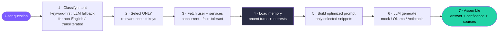
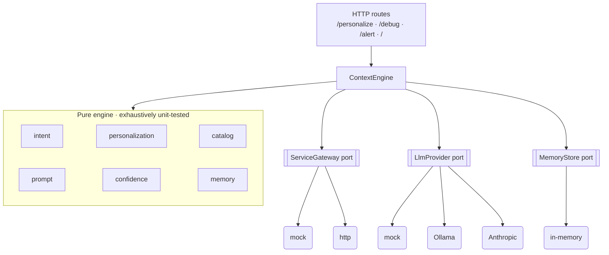

<div align="center">

# 🔮 MyNaksh — Personalized AI Context Engine

**The intelligence layer between structured astrology services and an LLM.**
It understands the question → selects *only* the relevant context → personalizes → builds an optimized prompt → returns a **grounded, confidence-scored** answer.


-blue)


</div>

> Design deep-dive lives in [`ARCHITECTURE.md`](./ARCHITECTURE.md). This README is how to run it, what's inside, and what I traded off.

---

## 🧠 How a request flows



`/debug/personalization` short-circuits after step 2 — it returns the engine's reasoning with **no LLM call**, so context selection is fully explainable.

---

## ✨ Highlights

| | |
|---|---|
| 🎯 **Context selection** | Each intent pulls *only* the context keys it needs — smaller prompts, lower cost, no "lost in the middle". `excludedContext` is derived, not hand-maintained. |
| 🗣️ **Multilingual intent** | Keyword-first (free, deterministic) with an **LLM fallback** that classifies non-English / transliterated questions (e.g. Tamil *"en vela epdi irukum"*) by meaning — firing *only* when keywords find nothing. |
| 🧠 **Memory layer** | **Short-term** (recent conversation) + **long-term** (recurring interests) behind a `MemoryStore` port — so answers are continuity-aware. Swappable for Redis / a vector store at scale. |
| 📊 **Confidence scoring** | `confidence = min(data-coverage, model self-assessment)` — HIGH only when both agree. `sourcesUsed` is **engine-derived**, never parsed from the model (can't hallucinate). |
| 🛡️ **Graceful degradation** | An upstream failure lowers confidence — it **never 500s**. |
| 🔌 **Ports & adapters** | `ServiceGateway` (mock/http) · `LlmProvider` (mock/Ollama/Anthropic) · `MemoryStore` (in-memory) — all swappable; defaults run with **zero secrets**. |
| 🖥️ **Live playground** | A built-in UI at `/` to watch the engine reason end-to-end. |
| 🪶 **1 runtime dependency** | Fastify only. LLM via native `fetch`, tests via `node:test`, logging hand-rolled. Every dependency earns its place. |

---

## 🏗️ Architecture (ports & adapters)



Composition root (`app.ts`) is the single place concrete adapters are wired — nothing downstream knows whether the gateway is mock or http, or which LLM is in use.

---

## 🚀 Run

```bash
npm install
npm start                 # http://localhost:3000   (or: npm run dev)
# ports 3000/4000 busy? → PORT=3100 npm start
```

Then open **`http://localhost:3000/`** for the live playground, or hit the API:

```bash
# Full pipeline
curl -s -X POST localhost:3000/personalize \
  -H 'content-type: application/json' \
  -d '{"userId":"user_101","question":"Should I consider changing my job soon?"}'

# Explain the reasoning — no LLM call
curl -s -X POST localhost:3000/debug/personalization \
  -H 'content-type: application/json' \
  -d '{"userId":"user_101","question":"Should I consider changing my job soon?"}'
```

<details>
<summary><b>Example responses</b></summary>

`/personalize`:
```json
{
  "answer": "Here's what your chart suggests: …",
  "confidence": "HIGH",
  "sourcesUsed": ["Career Horoscope", "10th House", "Current Dasha", "Today's Panchang"]
}
```

`/debug/personalization` (internal reasoning, safe to expose):
```json
{
  "intent": "career",
  "ambiguous": false,
  "intentScores": { "career": 1, "finance": 0, "health": 0, "relationship": 0, "general": 0 },
  "selectedContext": ["Career Horoscope", "10th House", "Current Dasha", "Today's Panchang"],
  "excludedContext": ["Finance Horoscope", "Health Horoscope", "Relationship Horoscope", "…"],
  "language": "English", "tone": "Motivational", "maxWords": 350
}
```
</details>

```bash
npm test          # 28 tests: intent, selection, confidence, catalog, memory, pipeline, HTTP
npm run typecheck # strict tsc, no emit
```

---

## 🔧 Configuration (env)

| Var | Default | Purpose |
| --- | --- | --- |
| `PORT` | `3000` | HTTP port |
| `GATEWAY` | `mock` | `mock` (in-process fixtures) or `http` (real fetch to the mock upstream) |
| `UPSTREAM_TIMEOUT_MS` | `800` | per-call hard timeout |
| `UPSTREAM_RETRIES` | `2` | bounded retries (backoff + jitter; 5xx/timeout only) |
| `CACHE_TTL_MS` | `60000` | in-memory cache TTL |
| `MOCK_FAIL_SERVICES` | – | CSV to fail (`user,kundli,horoscope,panchang`) — demo degradation |
| `LLM_PROVIDER` | `mock` | `mock` \| `ollama` (local) \| `anthropic` (cloud) |
| `OLLAMA_MODEL` | `llama3.2` | local model id |
| `ANTHROPIC_MODEL` | `claude-sonnet-4-6` | cloud model id |

<details>
<summary><b>Demonstrate the interesting paths</b></summary>

```bash
# Partial failure → confidence drops, failed source dropped, still answers
PORT=3100 MOCK_FAIL_SERVICES=horoscope npm start

# Real network path: boots a mock upstream and hits it over HTTP
PORT=3100 GATEWAY=http UPSTREAM_BASE_URL=http://127.0.0.1:4100 npm start

# Real LLM — local (free) or cloud
LLM_PROVIDER=ollama npm start
LLM_PROVIDER=anthropic ANTHROPIC_API_KEY=sk-... npm start
```
</details>

---

## 📁 Project layout

```
src/
  server.ts / app.ts        # bootstrap + composition root (the one wiring place)
  pipeline.ts               # the orchestration — read this first
  domain.ts                 # all domain types
  engine/                   # PURE, unit-tested core
    intent · rules.config · personalization · catalog · prompt · confidence · memory
  gateway/                  # PORT: ServiceGateway + Resilient decorator + mock/http
  llm/                      # PORT: LlmProvider + mock/ollama/anthropic + intent-classifier
  infra/                    # env, logger, cache
  routes/                   # HTTP routes (Fastify schema validation)
public/playground.html      # live demo UI served at /
test/                       # node:test — 28 tests
```

---

## 📐 Key design decisions

- **Context selection is pure & explainable** — no I/O, no LLM; exhaustively unit-tested and exposed via `/debug`.
- **`sourcesUsed` is engine-derived** — the keys actually resolved into the prompt, never parsed from the model.
- **Confidence = min(coverage, self-assessment)** — conservative; HIGH requires both to agree.
- **Memory is kept separate from grounded context** — the prompt uses it for *continuity only*, never as chart facts.
- **Ambiguous intent widens to `general`** rather than guessing a narrow, confident-but-wrong intent.

<details>
<summary><b>Trade-offs & what's next</b></summary>

**Intentionally simplified:** in-memory cache (not Redis) behind a `Cache` seam; one-shot JSON (no streaming); fault/latency injection via env.

**With more time:** Redis short-term memory + vector-store semantic long-term memory; a CI eval harness (labeled set asserting intent + sources); OpenTelemetry traces + per-upstream circuit breakers; rate limiting + idempotency keys; streaming + per-tier cost budgets.

**Production concerns left out:** authN/Z & tenancy, secrets management, horizontal-scale cache invalidation, prompt-injection hardening, PII/data-retention for birth details.
</details>
